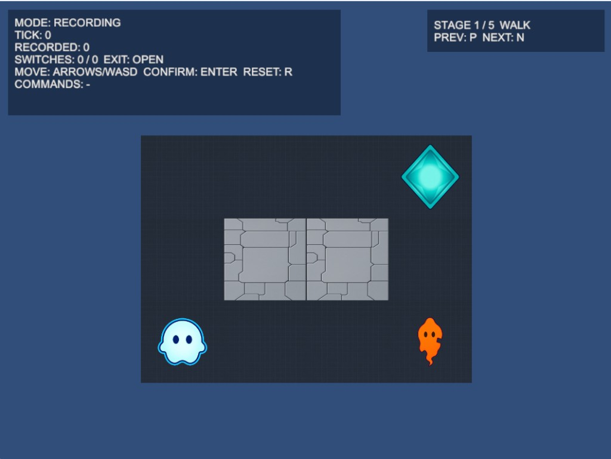

# SPECTER//TICK

**English summary:** SPECTER//TICK is a 2D grid puzzle where you record movement commands, confirm with Enter, then watch a Specter replay them so switches and doors open the exit. Core logic lives in a Unity-free UPM package; this repo is the Unity Presentation layer with 492 EditMode and 19 PlayMode tests. Five stages ship in `StageCatalog`. On launch, an English how-to-play overlay appears (press any key to continue; **H** reopens it). Windows 64-bit Mono standalone builds were verified via batchmode using a working-copy layout described in `docs/BUILD.md`.

---

## 概要

**SPECTER//TICK** は、プレイヤーが移動コマンドを記録し、確定後に **Specter（残像）** が同じ列を再生して、スイッチとドアを協力させる **2D グリッドパズル** です。ロジックは UPM パッケージ `com.yuya_hatano.specter-tick-core`（別リポジトリ）にあり、本リポジトリは Unity 上の入力・描画・UI を担当します。

## プレイ画面




## 遊び方

| モード | 主な操作（`InputGuide.cs`） |
|--------|------------------------------|
| Recording | 移動: 矢印 / WASD、確定: **Enter**、リセット: **R** |
| Playback | 1 Tick 進行: **Space**、リセット: **R** |
| Cleared | リセット: **R** |

流れ: **記録 → Enter で確定 → Playback で Space を押して Specter を進める → 出口条件を満たしてクリア**。起動時に **How to play** オーバーレイ（英語）が表示され、任意のキーで閉じられます。**H** でいつでも開き直せます。ステージ切替: **N**（次） / **P**（前、端でクランプ）。

ルールの詳細は [DESIGN_SPEC.md](DESIGN_SPEC.md) と [docs/STAGE_GUIDE.md](docs/STAGE_GUIDE.md) を参照してください。

## ステージ（5 件）

| 名前 | 概要 |
|------|------|
| **WALK** | スイッチなし。記録のみでクリアできる導入（`StageCatalog` index 0） |
| **ECHO** | 1 スイッチ。Specter が離れた位置から再生 |
| **GATE** | スイッチと 1 ドア |
| **TWIN** | 2 スイッチと 2 ドア |
| **TANGLE** | 2 スイッチと AND 条件の 2 ドア |

解の手順は [docs/STAGE_GUIDE.md](docs/STAGE_GUIDE.md) に記載しています。

## 技術的な特徴

- **3 層:** Core（Data + Logic、Unity 非依存）と Presentation（入力・描画・UI）。Core は `noEngineReferences: true`（`SpecterTick.Core.asmdef`）。
- **UPM 参照:** `Packages/manifest.json` の `file:../../SpecterTick.Core`（兄弟フォルダ配置）。詳細は [docs/BUILD.md](docs/BUILD.md)。
- **決定性:** 同じ初期状態と同じコマンド列で同じ結果になるよう Core をテスト（例: `GridPuzzleEngineSessionDeterminismTests`）。
- **テスト:** EditMode **492**（Core 286 + Presentation 206）、PlayMode **19**（`SpecterTick.Presentation.PlayModeTests`）。
- **非空虚性:** 開発時に、期待を壊した変異を適用して、対応するテストだけが失敗することを確認した（記録はリポジトリに含まない）。

## セットアップとビルド

1. `SpecterTick` と `SpecterTick.Core` を同じ親フォルダに並べる。
2. Unity **6000.3.26f1** で `SpecterTick` を開く。
3. テスト・CLI ビルド手順: [docs/BUILD.md](docs/BUILD.md)

リポジトリ URL: `https://github.com/yuya-hatano-abs/SpecterTick.git`

## リポジトリ構成（主要パス）

```text
SpecterTick/
  Assets/
    Scenes/SampleScene.unity
    SpecterTick/Presentation/
      Runtime/          … 35 C# + asmdef
      Tests/Editor/     … Presentation EditMode
      Tests/PlayMode/   … PlayMode 19 件
      Resources/Skin/   … 任意スキン PNG 10 枚
  Packages/manifest.json
  ProjectSettings/
  ArtSource/            … 加工前画像（MIT 対象外）
  DESIGN_SPEC.md
  docs/
SpecterTick.Core/       … 別リポジトリ（UPM）
```

## 実装状況と既知の制限

| 項目 | 状態 |
|------|------|
| MVP: グリッド移動・記録・再生・スイッチ/ドア・リトライ | 実装済み（Core + Presentation + テスト） |
| MVP: 決定性の単体テスト | 実装済み |
| MVP: 簡易デバッグ | **一部:** Playback の **Space**（`InputGuide` の STEP）と **HUD** による状態表示。**未実装:** 仕様書 §4.1 の **EditorWindow** デバッグツール |
| 演出・アニメーション・サウンド | なし |
| HUD / ステージラベル / クリア画面 | スキン対象外（図形＋テキスト） |
| How to play オーバーレイ（起動時・**H**） | 実装済み（英語 ASCII、`HowToPlayView`） |
| 図形の Player / Specter 区別 | コントラスト比 **1.13**（`PaletteContrastTests`） |
| スキン PNG の Player vs Specter 輝度比 | **1.5 以上**（`SkinAssetQualityTests.AS5`） |
| 内蔵 GPU での快適さ | **未測定**（FPS/メモリの記録なし） |
| WALK / ECHO / GATE の最短解 | 全探索テスト `SX1_Walk_ExhaustiveShortSolutions` 〜 `SX3_Gate_ExhaustiveShortSolutions` |
| TWIN / TANGLE の最短性 | 全探索テスト **なし**（`StageSolutionTests` クラスコメント） |
| 画面サイズ追従 | `ScreenSizeTrackerTests` の EditMode のみ |
| `LoadStage` 失敗時の挙動 | 自動テスト **なし** |
| 同時多キー | EditMode `InputIntentResolverTests`（**3** 件。`K3_Priority_Goldens` 等で複数キー同時押下時の優先順位）で検証。ドライバー経由の PlayMode は `PM8_NavigationFrame_ConsumesOtherKeys`（N と Right の同一フレーム）の **1 パターン**のみ。それ以外の組み合わせのドライバー経由自動テスト **なし** |

## 素材とライセンス

- **ソースコード:** [LICENSE](LICENSE)（MIT）。著作権表示は Core の `LICENSE` と同じ文言です。
- **画像素材**（`Assets/SpecterTick/Presentation/Resources/Skin/`、`ArtSource/`）: Grok で生成した画像を加工したもの。**MIT の対象外**です。生成ツールの利用規約に従ってください。再配布・再利用は、確認が取れるまで行わないでください（法的助言ではありません）。

## ドキュメント

| ファイル | 内容 |
|----------|------|
| [DESIGN_SPEC.md](DESIGN_SPEC.md) | ゲーム仕様・設計（§7 まで）+ 実装対応（末尾追記） |
| [docs/ARCHITECTURE.md](docs/ARCHITECTURE.md) | アーキテクチャとテスト方針 |
| [docs/BUILD.md](docs/BUILD.md) | セットアップ・テスト・ビルド |
| [docs/STAGE_GUIDE.md](docs/STAGE_GUIDE.md) | ステージと解 |
| [CHANGELOG.md](CHANGELOG.md) | 変更履歴 |

## Core パッケージ

ロジック本体は `SpecterTick.Core`（`https://github.com/yuya-hatano-abs/SpecterTick.Core.git`）。
