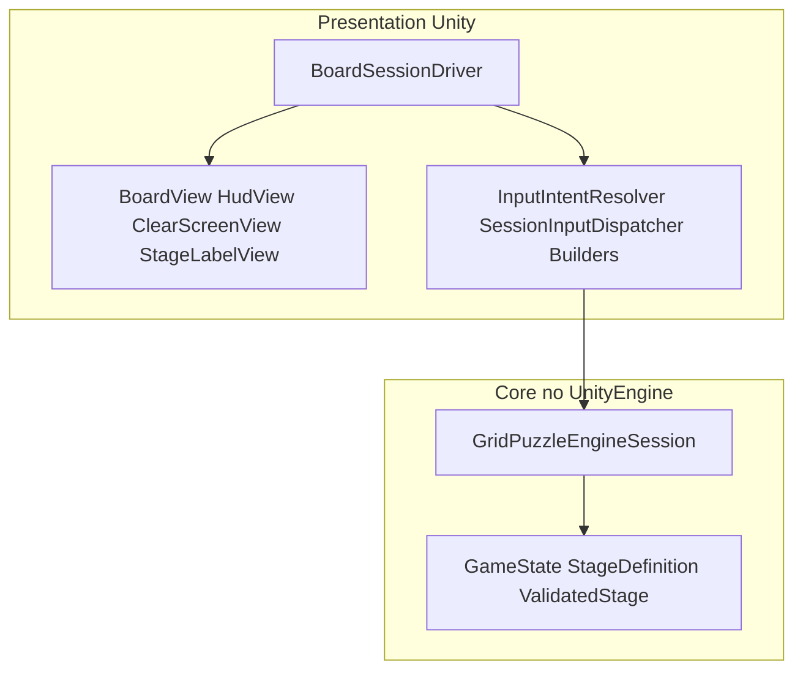
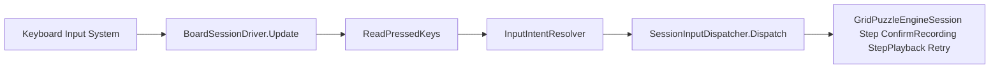

# アーキテクチャ

SPECTER//TICK は **ゲーム（Unity）** と **Core（UPM）** の 2 リポジトリ構成です。ゲームロジックとデータは `UnityEngine` に依存しない Core にあり、Presentation が入力を読み、セッション API を駆動し、盤面を描画します。

## リポジトリ構成

```text
SpecterTick/                 ← Unity ゲーム（本リポジトリ）
  Assets/SpecterTick/Presentation/
  Packages/manifest.json     → file:../../SpecterTick.Core
SpecterTick.Core/            ← com.yuya_hatano.specter-tick-core 0.1.0
  Runtime/                   … エンジン + ステージモデル
  Tests/Editor/              … EditMode 286 件
```

## レイヤー



## 入力経路



参照ファイル: `BoardSessionDriver.cs`、`SessionInputDispatcher.cs`（Presentation）、`GridPuzzleEngineSession.cs`（Core）。

## Core（`Runtime/` — 29 個の .cs ファイル）

アセンブリ: `SpecterTick.Core.asmdef`（`"noEngineReferences": true`）。テスト向けに `[assembly: InternalsVisibleTo("SpecterTick.Core.Tests")]`（`AssemblyInfo.cs`）。

**公開型を含むファイル 25 件**（`public` の型・インターフェース・列挙などの宣言がある .cs）。**公開型を含まないファイル 4 件:** `ActivatedSwitchSet.cs`、`AssemblyInfo.cs`、`GameModeUtility.cs`、`StageLayoutSnapshot.cs`。

| 領域 | 型 | 役割 |
|------|-----|------|
| Session | `IGameEngine`, `GridPuzzleEngineSession` | Tick 実行、記録、再生、リトライ |
| State | `GameState`, `GameMode`, `RecordedCommand`, `RecordedCommandSequence`, `ActivatedSwitchSet`（internal）, `StageLayoutSnapshot`（internal） | 不変スナップショットとコマンド列 |
| Grid | `GridPosition`, `MoveDirection`（+ ユーティリティ） | 整数グリッド座標と方向 |
| Stage model | `StageDefinition`, `ValidatedStage`, `IStage`, 配置、`StageDoor`, `StageSwitch`, … | ステージ定義と検証 |
| Validation | `StageValidator`, `StageValidationResult`, エラー型 | ステージ定義の検証 |

Presentation が呼ぶエンジン API: `Step`、`ConfirmRecording`、`StepPlayback`、`Retry`（`GridPuzzleEngineSession.cs`）。

## Core ルール（実装）

| ルール | 実装 / テスト |
|--------|----------------|
| 参照スイッチがすべて作動中ならドアが開く | `GridPuzzleEngineSessionSwitchDoorTests` |
| 全スイッチ作動で出口が開く。スイッチ 0 個なら開始時から開く | `Session_ZeroSwitches_AllSwitchesActivatedAndExitOpen_AreTrueAtTickZero` |
| スイッチはラッチ | `StageLayoutSnapshotLatchTests` |
| 確定でラッチを空に戻し位置を再評価 | `GridPuzzleEngineSessionRecordingPlaybackTests` G9a/b |
| 拒否された移動も記録され Tick は進む | `Step_Recording_RejectedMove_StillAppendsCommand` |
| 空記録 + 確定 → Playback | `ConfirmRecording_EmptySequence_AllowsPlaybackFinished` |
| Recording 中は Cleared にならない | `Recording_F2_G11_NoClearWhileRecording` |
| Player は Specter のマスに入れる | `GridPuzzleEngineSessionTests.Step_PlayerCanEnterSpecterCell_NoSpecialHandling` |
| 全モードから Retry | `GridPuzzleEngineSessionRetryTests`、PlayMode `PM4_Retry_FromAllModes` |

## Presentation（`Runtime/` — 30 個の .cs ファイル）

アセンブリ: `SpecterTick.Presentation.asmdef`（Core、Input System、UGUI を参照）。

### MonoBehaviour と純粋ロジック

`Runtime/` 下で `: MonoBehaviour` を継承する型は **5 つ**:

| 型 | 役割 |
|----|------|
| `BoardSessionDriver` | シーン駆動: 入力、セッション、View 更新 |
| `BoardView` | グリッド描画、カメラフィット、任意スキン |
| `HudView` | `HudModelBuilder` 由来の HUD テキスト |
| `ClearScreenView` | `ClearScreenModelBuilder` 由来のクリア表示 |
| `StageLabelView` | ステージ名ラベル |

それ以外の Runtime 型は通常の C#（ビルダー、モデル、ディスパッチャ、`StageCatalog`、`InputGuide` など）。`BoardSkin` / `BoardSkinLoader` は `UnityEngine` を使うが `MonoBehaviour` ではない。

### 描画更新

入力が実行されたあと（`BoardSessionDriver`）:

1. `_boardView.UpdateActors(_session.State)`
2. `_boardView.UpdateElements(BoardElementsModelBuilder.Build(_session))`
3. `RefreshHud()` → `HudView.Apply(HudModelBuilder.Build(_session))`
4. `RefreshClearScreen()` → クリア用ビルダー + View

初期表示: `LoadStage()` が `BoardView.Show(stage)` と上記リフレッシュを呼ぶ。

### スキン（任意）

`BoardSessionDriver.Start` が `BoardSkinLoader.Load()` と `BoardView.ApplySkin` を呼ぶ。スプライト欠落時は図形描画のまま（`BoardSkin.MissingCount`、警告ログ）。テスト: `BoardViewSkinTests`、`SkinAssetQualityTests`。

Presentation Runtime で `Resources.Load` を呼ぶのは **`BoardSkinLoader.cs` のみ**（`BoardView.cs` は `ReleaseResources` などはあるが `Resources.Load` は呼ばない）。

### ステージフロー

`StageFlow` + `StageCatalog`（5 ステージ）。**N / P** は `StageNavigationResolver` で解釈し、ナビゲーションで `LoadStage()` により再読込。

## テスト方針

| レイヤー | アセンブリ | 件数 | 役割 |
|----------|------------|-----:|------|
| Core EditMode | `SpecterTick.Core.Tests` | 286 | ルール、検証、決定性、リトライ、スイッチ/ドア |
| Presentation EditMode | `SpecterTick.Presentation.Tests` | 163 | モデル、View、カタログ解、ビルド設定 |
| PlayMode | `SpecterTick.Presentation.PlayModeTests` | 11 | `BoardSessionDriver` 統合（入力、HUD、モード） |

**キャラクタリゼーション:** Core セッションテストのゴールデン列、`StageSolutionTests` の SS/SN/SX。

**非空虚性:** 開発時に意図的な変異をドライバー等に入れ、期待どおりのテストだけが失敗することを確認した（記録はリポジトリに含まない）。

**自動化の範囲外（例）:** `ScreenSizeTracker` の単体テストを超えるウィンドウリサイズ、ビルドプレイヤーでの入力フォーカス、スキンの視覚品質そのもの。

**同時多キー（事実）:**

- EditMode **`InputIntentResolverTests`**（**3** 件）が、`InputKeys` に複数キーが同時に立っている場合の **`InputIntentResolver.Resolve` の優先順位**を検証する（代表: `K3_Priority_Goldens`）。
- **ドライバー経由**で同一フレームに複数キーを押す PlayMode テストは、**`PM8_NavigationFrame_ConsumesOtherKeys`**（N と Right）の **1 パターン**のみ。
- 上記以外のキー組み合わせについて、**ドライバー経由の自動テストはない**。

## 設計上の事実

- **ホールドリピートなし:** 1 物理キー押下 → 1 フレームあたり高々 1 論理インテント（`ReadPressedKeys` は `wasPressedThisFrame` を使用）。
- **スキン読込:** Presentation Runtime で `Resources.Load` を呼ぶのは `BoardSkinLoader` のみ（上記）。
- **決定性:** Core に `UnityEngine.Random` やフレーム時間を使わない。`GridPuzzleEngineSessionDeterminismTests` を含む。

## 既知の制限

[README](../README.md) の「実装状況と既知の制限」を参照。仕様 MVP の EditorWindow デバッグツールは未実装。Playback の Space と HUD テキストが部分的な可視性を提供する。
